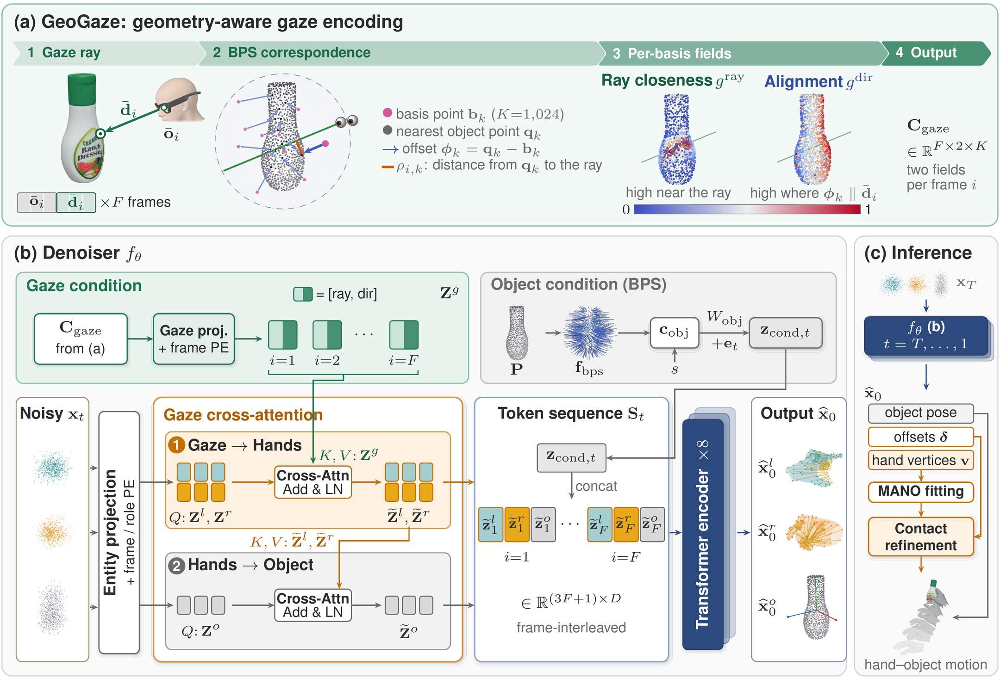

<div align="center">

# 👁️ GRAZE

### Text-Free Grasp Synthesis for Unseen Objects from Human Gaze

<sub><b>GR</b>asp from g<b>AZE</b> · look at it, and the hand grasps it</sub>

<br>

<a href="https://leejeongho3214.github.io/GRAZE/"></a>
<a href="https://leejeongho3214.github.io/GRAZE/#video"></a>
<a href="https://arxiv.org/abs/2611.21104"></a>
<a href="#pretrained-models"></a>

<!-- TODO: author list and affiliations -->

</div>

<br>

<p align="center"><a href="https://leejeongho3214.github.io/GRAZE/#video"></a></p>

GRAZE generates a hand–object grasp motion for an object it has never seen. Its inputs are the
object's point cloud, the object's initial pose, and the egocentric gaze rays of the first 30%
of the clip. No text prompt names the object or the part.

This repository contains the code to train GRAZE, generate grasps, and score them on
**HOT3D-Grasp**. HOT3D-Grasp is our grasp-centered benchmark built on
[HOT3D](https://facebookresearch.github.io/hot3d/): 912 clips of 31 objects in three
object-disjoint folds.

<p align="center"></p>

## Contents

- [Installation](#installation)
- [Assets](#assets)
- [Data preparation](#data-preparation)
- [Pretrained models](#pretrained-models)
- [Training](#training)
- [Inference](#inference)
- [Evaluation](#evaluation)
- [Expected results](#expected-results)
- [Repository layout](#repository-layout)
- [Citation](#citation)
- [License](#license)
- [Acknowledgements](#acknowledgements)

## Installation

Tested on Linux with Python 3.8, PyTorch 1.13.0, CUDA 11.6 and PyTorch3D 0.7.2.

```bash
git clone https://github.com/leejeongho3214/GRAZE.git
cd GRAZE
conda env create -f environment.yml
conda activate graze
# PyTorch3D 0.7.2 (see https://github.com/facebookresearch/pytorch3d/blob/main/INSTALL.md)
conda install -c fvcore -c iopath -c conda-forge fvcore iopath
conda install -c pytorch3d pytorch3d=0.7.2
```

Weights & Biases logging is off by default. To turn it on, add `use_wandb=true` to a training command.

## Assets

The following files are not distributed with this repository. Put them in `assets/` and `data/`:

| File | Source | Used for |
|---|---|---|
| `assets/bps.pt` | `GRAB_HANDS/bps.pt` from the [DiffH2O](https://github.com/facebookresearch/diffh2o) data release (1,024 basis points, key `obj`) | BPS object encoding and GeoGaze. The released checkpoints work only with this exact basis. |
| `assets/part_fps_hand_index_100.npy` | `assets/part_fps_hand_index_100.npy` from [BimArt](https://github.com/RosettaWYzhang/BimArt) | The 100 MANO vertices per hand that the model predicts |
| `data/mano/mano_v1_2/models/MANO_{LEFT,RIGHT}.pkl` | [MANO](https://mano.is.tue.mpg.de/) (registration required) | Hand model |

<!-- TODO: confirm the download locations of bps.pt and part_fps_hand_index_100.npy -->

## Data preparation

HOT3D-Grasp is built from the HOT3D dataset. HOT3D data and meshes cannot be
redistributed, so you have to download HOT3D yourself and rebuild the benchmark files.
This repository ships only our own annotations, in [`benchmark/hot3d_grasp/`](benchmark/hot3d_grasp):

| File | Content |
|---|---|
| `clip_annotations.csv` | Manually annotated grasp actions: HOT3D sequence, object, contact frame, prompt (part and hand), grasp start and end frames |
| `threefold_assignment.json` | Objects of the three object folds (and of the three subject folds) |
| `manifest.json` | Clip counts and held-out objects per fold |
| `labels_merged.json` | Part labels of the 31 objects, as indices into the 1,024-point object clouds (used for Part Acc. and PCP) |
| `excluded_clips.json` | The 3 test clips without ground-truth contact, which every metric drops (915 → 912 clips) |
| `text.json` | Prompt templates of the clips (only the hand side is read at test time) |

Expected layout under `data/`:

```
data/
├── mano/mano_v1_2/models/            MANO_LEFT.pkl, MANO_RIGHT.pkl
└── hot3d/
    ├── previous/                     HOT3D object models <id>.glb + instance.json (read by the loader)
    ├── object_mesh/                  <id>.ply  (HOT3D models as .ply)
    ├── pre-process/                  <id>.ply  (simplified HOT3D models, read by the data loader)
    ├── data/acc_ori.pkl              per-action hand / object / camera / gaze tracks extracted from HOT3D
    ├── pre-process_dataset/acc_ori.pkl   the same tracks, grouped by object
    └── dataset/
        ├── obj.pkl                   1,024-point clouds + normals (farthest point sampling)
        ├── ori_dataset/gaze_{train,test}.pkl   intermediate, read only by build_threefold.py
        └── threefold/obj{0,1,2}_{train,test}.pkl, manifest.json
```

Steps:

```bash
# 1. Per-action tracks from the HOT3D recordings and clip_annotations.csv
#    -> data/hot3d/data/acc_ori.pkl
#    TODO: extraction script (HOT3D toolkit) not included yet
# 2. Group by object -> data/hot3d/pre-process_dataset/acc_ori.pkl
python preprocess/group_by_object.py
# 3. Object meshes -> data/hot3d/object_mesh/*.ply and data/hot3d/pre-process/*.ply
#    TODO: conversion script not included yet
# 4. 1,024-point object clouds -> data/hot3d/dataset/obj.pkl
python preprocess/preprocessing_hot3d.py --step object
# 5. Clips with contact and gaze maps -> data/hot3d/dataset/ori_dataset/gaze_{train,test}.pkl
python preprocess/preprocessing_hot3d.py --step clips
# 6. Pool both splits (915 clips) and write the 3-fold splits
python preprocess/build_threefold.py
```

Training, inference and evaluation read only `obj.pkl`, the `threefold/` files, the meshes and
`previous/instance.json`; `data/acc_ori.pkl`, `pre-process_dataset/` and `ori_dataset/` are needed
only to rebuild the splits.

Fold `obj<k>` tests on the objects of fold k and trains on the other two folds
(302 / 311 / 302 test clips, 613 / 604 / 613 training clips). The training loader skips
clips without hand annotations (obj0: 613 → 611).

## Pretrained models

There is one checkpoint per object fold. Each is the epoch-4000 model used in the paper, with the optimizer state removed:

| Fold | File |
|---|---|
| obj0 | `graze_obj0.pth` |
| obj1 | `graze_obj1.pth` |
| obj2 | `graze_obj2.pth` |

Download: **TODO (link)**. Put the files in `checkpoints/` and check them against
[`checkpoints/SHA256SUMS`](checkpoints/SHA256SUMS). Each checkpoint stores the model weights, the
model settings and the motion normalization statistics.

## Training

The defaults in `configs/` are the settings of the released model. To train one fold:

```bash
bash scripts/train.sh obj0        # = python graze/train.py fold=obj0
```

This command trains for 4,000 epochs with batch size 64 and AdamW (lr 1e-4), and writes
`outputs/graze_obj0/epoch_4000.pth`. It takes about 14 h on one GPU. Training is not
bit-wise deterministic. At the start of training, the motion normalization statistics are
computed from the training split. They are stored in every checkpoint.

## Inference

```bash
bash scripts/test.sh obj0 checkpoints/graze_obj0.pth
```

This command does the following:

- It samples 10 motions per test clip (seeds 0–9, DDPM with 1,000 steps).
- It fits MANO to the predicted hand points.
- It runs the contact refinement (300 steps).

As in training, the gaze of the first 30% of each clip's valid frames is kept and the rest is
zeroed. The output is `results/graze_obj0.pkl`.

Runtime: one seed of fold obj0 (302 clips) took 52 min on one shared GPU, so the full
10 seeds of one fold take about 5–9 h. To run fewer seeds, append
`texthom.exp.num_test_seeds=<n>`.

As in the paper, the model is also given the initial object pose, the clip length and the
active hands. The active hands are read from the hand words of the prompt.

## Evaluation

```bash
bash scripts/eval.sh obj0         # per-frame metrics (GPU) + physics simulation (PyBullet)
```

The evaluator in `eval/` reads `eval/data/obj.pkl` and `eval/data/object_mesh/`. Link them to your data:

```bash
mkdir -p eval/data
ln -s ../../data/hot3d/dataset/obj.pkl eval/data/obj.pkl
ln -s ../../data/hot3d/object_mesh eval/data/object_mesh
```

After all three folds are scored, build the table row:

```bash
python scripts/make_table1.py \
  --csv obj0 results/graze_obj0.csv --csv obj1 results/graze_obj1.csv --csv obj2 results/graze_obj2.csv \
  --sim obj0 results/sim_obj0.csv  --sim obj1 results/sim_obj1.csv  --sim obj2 results/sim_obj2.csv
```

The simulation step (Sim. / SimD) needs PyBullet (`pybullet==3.2.6`, in `requirements.txt`).
Scoring one seed takes about 5 min (metrics) plus a few seconds (simulation).

Each metric is computed per generated sample and then averaged. The row is the mean of the three folds.

- **GSR** (grasp success): all three conditions must hold:
  - contact on each of the last 5 frames,
  - final penetration depth ≤ 1 cm,
  - the object lifted ≥ 5 mm along the HOT3D world up `u = [0.0946, −0.6165, 0.7816]`.
- **Part Acc.** / **PCP**: whether the final contact lies on the target part.
- **ID**: penetration depth (mm), averaged over penetrating frames.
- **Sim.** / **SimD**: a physics simulation with the hands fixed. Sim. is the share of grasps whose
  object moves less than 2 cm, and SimD is the mean object displacement (cm).

## Expected results

HOT3D-Grasp, 912 clips, 10 samples per clip (paper Table 1):

| | GSR ↑ | Part Acc. ↑ | PCP ↑ | ID ↓ | Sim. ↑ | SimD ↓ |
|:--|:-:|:-:|:-:|:-:|:-:|:-:|
| GRAZE | 66.3 | 49.3 | 50.1 | 6.7 | 74.5 | 2.04 |

Per fold (GSR / Part Acc. / PCP): obj0 53.6 / 56.0 / 56.9, obj1 68.8 / 51.7 / 51.1, obj2 76.6 / 40.2 / 42.1.

## Repository layout

```
graze/train.py, graze/test.py      training and inference (+ MANO fit and refinement)
configs/                           Hydra configs (texthom/texthom.yaml = model and experiment)
lib/networks/texthom.py            gaze-conditioned diffusion Transformer
lib/networks/diffusion.py          DDPM
lib/utils/texthom_train_helpers.py GeoGaze (BPS ray closeness + alignment), targets, MANO fit, refinement
lib/datasets/h2o.py                HOT3D-Grasp data loader (MotionHOT3D)
preprocess/                        benchmark construction
eval/                              metrics (run_eval_gpu.sh) and physics simulation
scripts/                           train / test / eval wrappers and the table script
benchmark/hot3d_grasp/             our annotations and splits
docs/                              project page (GitHub Pages)
```

The code started from [Text2HOI](https://github.com/JunukCha/Text2HOI), so some module and
config names keep the `texthom` prefix. The code also contains switches for the paper's
ablations. Their defaults are the settings of the released model.

Implementation details that are easy to miss:

- The object BPS feature and the ray closeness use nearest points on the object mesh vertices.
  The displacement alignment uses nearest points of the 1,024-point object cloud.
- Condition dropout (p = 0.1) is applied to the gaze tokens and, independently, to the object condition.
- The hand output heads also see the encoded object token.
- The MANO fit optimizes shape, but the refined and saved hands use the mean shape.
- Training visits the clips in a fixed order, with no shuffling or re-weighting.
- The contact refinement uses 256 object points (with normals) sampled from the 1,024-point cloud.
- `use_lift_gate` builds an auxiliary head that no loss trains. It exists only so that the
  released checkpoints load.

## Citation

```bibtex
@article{graze2026,
  title   = {GRAZE: Text-Free Grasp Synthesis for Unseen Objects from Human Gaze},
  author  = {TODO},
  journal = {arXiv preprint arXiv:2611.21104},
  year    = {2026}
}
```

## License

The code in this repository is released under the [MIT License](LICENSE). Parts of it come from
other projects under their own licenses; see [THIRD_PARTY_NOTICES.md](THIRD_PARTY_NOTICES.md).

The following are not part of this repository and keep their own terms: HOT3D, MANO, the
DiffH2O/GRAB BPS basis, and the BimArt hand-vertex indices.

The files in `benchmark/hot3d_grasp/` annotate HOT3D; see
[benchmark/hot3d_grasp/README.md](benchmark/hot3d_grasp/README.md).
<!-- TODO: license of the pretrained checkpoints (trained on HOT3D) -->

## Acknowledgements

This code builds on [Text2HOI](https://github.com/JunukCha/Text2HOI). We thank the authors of:

- [HOT3D](https://facebookresearch.github.io/hot3d/), [MANO](https://mano.is.tue.mpg.de/),
  [smplx](https://github.com/vchoutas/smplx) and [PyTorch3D](https://github.com/facebookresearch/pytorch3d);
- [DiffH2O](https://github.com/facebookresearch/diffh2o) and [GRAB](https://grab.is.tue.mpg.de/), for the BPS basis;
- [BimArt](https://github.com/RosettaWYzhang/BimArt), for the hand-vertex subset and the
  post-optimization design that our contact refinement follows;
- [ObMan](https://github.com/hassony2/obman_train), for the simulation protocol.
