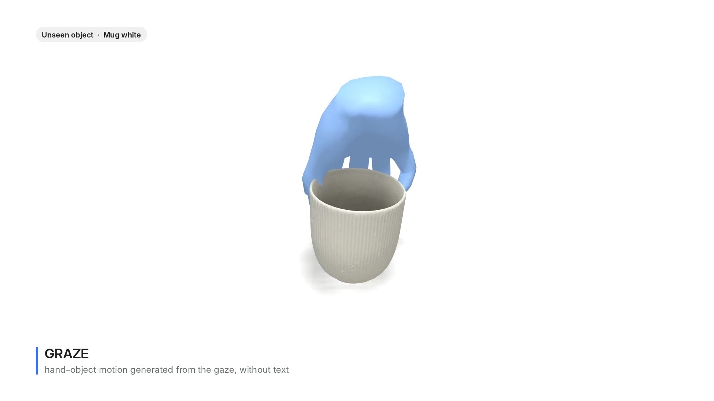
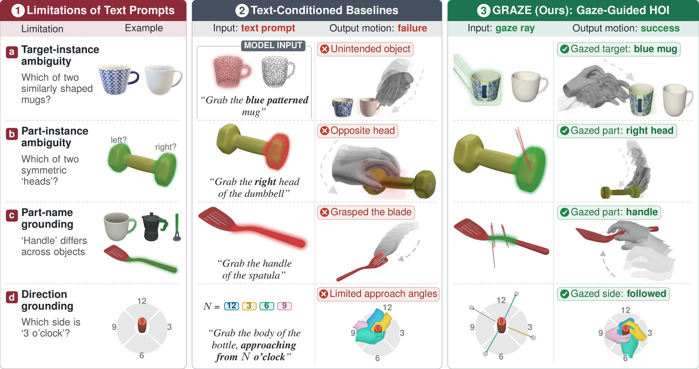

# GRAZE: Text-Free Grasp Synthesis for Unseen Objects from Human Gaze

**GRAZE** (GRAsp from gaZE) generates a full grasp-and-lift motion of the hands and the object from **where a person looks**. It needs no text prompt and works on objects it has never seen.

  <a href="https://leejeongho3214.github.io/GRAZE/"><b>Project page</b></a> &nbsp;·&nbsp;
  <a href="https://leejeongho3214.github.io/GRAZE/#video"><b>Video</b></a> &nbsp;·&nbsp;
  Paper (coming soon) &nbsp;·&nbsp;
  Code (coming soon)

  

## Why gaze instead of text?

Text prompts name objects and parts, but they cannot easily say *where* to grasp: the same word refers to different places on different objects, symmetric parts have no unambiguous name, and the approach side needs a reference frame that a prompt lacks. People, however, look at an object where they are about to grasp it.

## Method

GRAZE takes the object's point cloud, its initial pose, and the recorded gaze rays of the first 30% of the clip.

- **Geometry-Aware Gaze Encoding (GeoGaze)** maps each gaze ray onto fixed Basis Point Set (BPS) points:
  - *ray closeness* says how near each object point is to the ray;
  - *displacement alignment* says from which side the ray comes.
- **Gaze conditioning:** a diffusion Transformer generates hand and object motion, and its hand tokens attend to the gaze cues.
- **Inference:** MANO hands are fitted to the predicted vertices. A short contact refinement then settles the grasp, guided by predicted hand-to-object displacements.

## Results

These are results on **HOT3D-Grasp**, our grasp-centered benchmark built on HOT3D (912 clips, 31 objects). It uses three object-disjoint folds, so every test object is unseen in training. Numbers average ten samples per clip. Each text baseline is told the part in its prompt; GRAZE sees only the gaze.

| Method | Input | Grasp success | Part Acc. | Part contact (PCP) | Sim. stable |
|---|---|---|---|---|---|
| Text2HOI | text | 35.3 | 36.8 | 36.6 | 44.0 |
| DiffH2O | text | 17.9 | 31.7 | 31.0 | 27.8 |
| LatentHOI | text | 46.6 | 43.6 | 42.5 | 40.7 |
| OpenHOI | text | 25.8 | 31.5 | 31.0 | 31.7 |
| **GRAZE** | gaze | **66.3** | **49.3** | **50.1** | **74.5** |

- **Approach side follows the gaze:** when the recorded gaze is rotated around the object, the approach of GRAZE turns with it in 59.1% of cases. A text model retrained with clock words ("from 3 o'clock") follows a changed word in only 20.5%.
- **Zero-shot transfer:** without fine-tuning, GRAZE reaches 45.3% grasp success on the separate GazeHOI dataset, against 33.8% for the best baseline.

## Release

The paper, code, pretrained models and the HOT3D-Grasp splits will be released here.

## Acknowledgements

Built on the [HOT3D](https://facebookresearch.github.io/hot3d/) dataset and the [MANO](https://mano.is.tue.mpg.de/) hand model.
