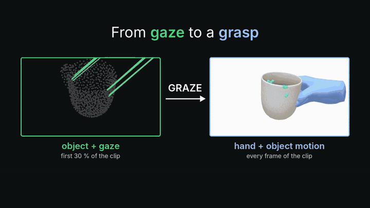

# 👁️ GRAZE

### Text-Free Grasp Synthesis for Unseen Objects from Human Gaze

<b>GR</b>asp from g<b>AZE</b> · look at it, and the hand grasps it

 

 

Input recording with gaze → generated grasp on an unseen object → comparison with text-conditioned models → rotating the gaze.

---

## ✨ Highlights

<table>
<tr>
<td width="33%" align="center"><h2>66.3%</h2><b>grasp success</b> best text model 46.6%</td>
<td width="33%" align="center"><h2>49.3%</h2><b>target-part accuracy</b> without being told the part · best text model 43.6%</td>
<td width="33%" align="center"><h2>59.1%</h2><b>follows a rotated gaze</b> text model with clock words 20.5%</td>
</tr>
</table>

## 🤔 Why gaze instead of text?

Text prompts name objects and parts, but they cannot easily say **where** to grasp:

- the same part word means different places on different objects,
- symmetric parts (*which* head of a dumbbell?) have no unambiguous name,
- the approach side needs a reference frame that a prompt lacks.

People, however, look at an object where they are about to grasp it.

## 🧠 Method

GRAZE takes the object's point cloud, its initial pose, and the recorded gaze rays of the **first 30%** of the clip. It generates the whole hand–object motion.

| | |
|---|---|
| **GeoGaze** | Each gaze ray is mapped onto fixed Basis Point Set (BPS) points. *Ray closeness* tells how near each object point is to the ray; *displacement alignment* tells from which side the ray comes. |
| **Gaze conditioning** | A diffusion Transformer generates hand and object motion. Its hand tokens attend to the gaze cues. |
| **Inference** | MANO hands are fitted to the predicted vertices. A short contact refinement then settles the grasp, guided by predicted hand-to-object displacements. |

## 📊 Results on unseen objects

**HOT3D-Grasp** is our grasp-centered benchmark built on HOT3D: 912 clips of 31 objects in three object-disjoint folds, so every test object is unseen in training. Numbers average ten samples per clip. Each text baseline is told the part in its prompt; GRAZE sees only the gaze.

| Method | Input | Grasp success ↑ | Part Acc. ↑ | PCP ↑ | Sim. stable ↑ |
|:--|:-:|:-:|:-:|:-:|:-:|
| Text2HOI | 📝 text | 35.3 | 36.8 | 36.6 | 44.0 |
| DiffH2O | 📝 text | 17.9 | 31.7 | 31.0 | 27.8 |
| LatentHOI | 📝 text | 46.6 | 43.6 | 42.5 | 40.7 |
| OpenHOI | 📝 text | 25.8 | 31.5 | 31.0 | 31.7 |
| **GRAZE (ours)** | 👁️ **gaze** | **66.3** | **49.3** | **50.1** | **74.5** |

- 🔄 **The approach follows the gaze.** When the recorded gaze is rotated around the object, the approach of GRAZE turns with it in 59.1% of cases. A text model retrained with clock words ("from 3 o'clock") follows a changed word in only 20.5%.
- 🌍 **Zero-shot transfer.** Without fine-tuning, GRAZE reaches 45.3% grasp success on the separate GazeHOI dataset, against 33.8% for the best baseline.

## 📦 Release

- [x] Project page and video
- [ ] Paper
- [ ] Code and pretrained models
- [ ] HOT3D-Grasp splits and part annotations

## 🙏 Acknowledgements

Built on the [HOT3D](https://facebookresearch.github.io/hot3d/) dataset and the [MANO](https://mano.is.tue.mpg.de/) hand model.
